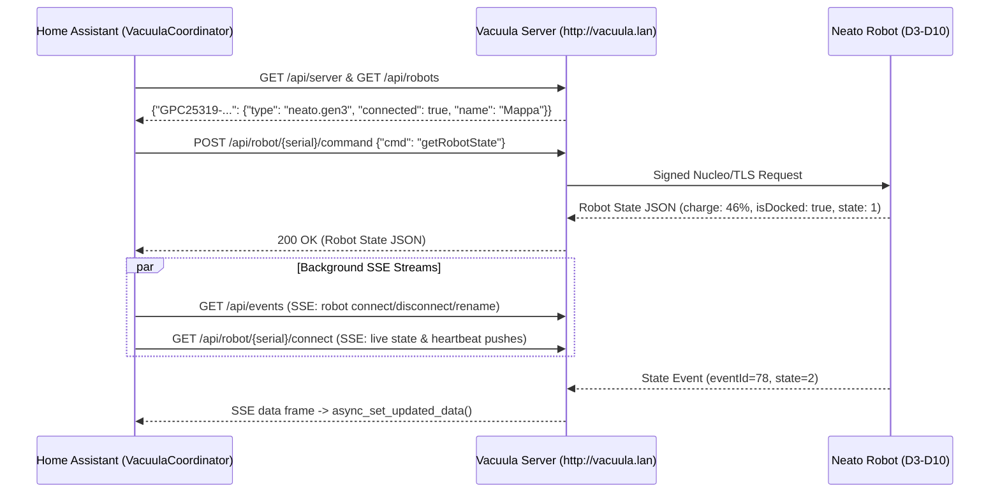

# Home Assistant HACS Integration Outline: `hass-vacuula`

## 1. Overview & Goals
`hass-vacuula` is a custom Home Assistant integration (distributable via **HACS**) that connects a local [Vacuula](https://github.com/vacuula/vacuula) server instance to Home Assistant. Because a single Vacuula server can manage multiple Neato robots across both **Gen3** (`D3`–`D7`, e.g., `BotVacD7Connected`) and **Gen4** (`D800`, `D8`–`D10`) generations, the integration models the **Vacuula Server** as the `ConfigEntry` hub and dynamically registers each linked robot as a Home Assistant `DeviceEntry`.

---

## 2. Repository & Directory Structure (HACS Standard)

```text
hass-vacuula/
├── hacs.json                              # HACS repository metadata
├── README.md                              # User installation & configuration guide
├── ARCHITECTURE.md                        # Technical design & Vacuula API specification
└── custom_components/
    └── vacuula/
        ├── __init__.py                    # ConfigEntry setup, unload, and dynamic robot discovery
        ├── manifest.json                  # Integration manifest (zeroconf: _vacuula._tcp.local.)
        ├── const.py                       # Domain constants, enums, and command mappings
        ├── api.py                         # Async HTTP + SSE client for Vacuula Server (aiohttp)
        ├── coordinator.py                 # Hybrid SSE push + fallback poll DataUpdateCoordinator
        ├── config_flow.py                 # UI setup flow (mDNS Zeroconf discovery + manual URL)
        ├── entity.py                      # Base VacuulaEntity binding entities to robot DeviceInfo
        ├── vacuum.py                      # StateVacuumEntity (Gen3 & Gen4 adapters)
        ├── sensor.py                      # Battery %, cleaning area, duration, error/alert state
        ├── binary_sensor.py               # Connected, docked, charging, bin full, schedule enabled
        ├── button.py                      # Locate ("Find Me"), Dismiss Alert
        ├── switch.py                      # Schedule Enable/Disable toggle
        ├── select.py                      # Cleaning Mode (Eco/Turbo) & Navigation Mode (Normal/Extra Care)
        ├── services.yaml                  # Custom action definitions (e.g., vacuula.clean_zones)
        ├── strings.json                   # UI strings
        └── translations/
            └── en.json                    # English localization
```

---

## 3. Vacuula Server API Specification

The Vacuula server exposes an unauthenticated local HTTP JSON + Server-Sent Events (SSE) API on `VACUULA_PORT` (port `80` via Traefik at `http://vacuula.lan` / `http://vacuula.local`, or port `8085` directly).

### 3.1 Server & Discovery Endpoints
| Method | Endpoint | Description | Sample Response |
| :--- | :--- | :--- | :--- |
| `GET` | `/api/server` | Server version, ports, and timezone | `{"version": "1.0.0", "gen4_port": 3443, "timezone": "Europe/Oslo", "utc_offset_minutes": 120}` |
| `GET` | `/api/robots` | Map of all paired robots keyed by serial | `{"GPC25319-f8369bfb9a1e": {"type": "neato.gen3", "connected": true, "name": "Mappa"}}` |
| `GET` | `/api/events` | Server-wide SSE stream (`event: robots` on connect/disconnect/rename) | `event: robots\ndata: {"GPC25319-...": {...}}\n\n` |

### 3.2 Per-Robot Endpoints
| Method | Endpoint | Description |
| :--- | :--- | :--- |
| `GET` | `/api/robot/{serial}/connect` | Real-time SSE stream of robot state updates & events |
| `POST` | `/api/robot/{serial}/command` | Synchronous command execution (waits up to 30s for robot reply) |
| `POST` | `/api/robot/{serial}` | Rename robot (`{"name": "New Name"}`) |
| `GET` | `/api/robot/{serial}/maps` | List saved persistent maps (`PersistentMap` for Gen3, `FloorPlan` for Gen4) |
| `GET` | `/api/robot/{serial}/maps/{map_id}` | Fetch floorplan JSON (`floormap.json`) |
| `GET` | `/api/robot/{serial}/maps/{map_id}/boundaries` | Fetch Gen4 zones/no-go polygons (`Gen3` uses `getMapBoundaries` command) |
| `GET` | `/api/robot/{serial}/runs` | List historical cleaning runs |

---

## 4. Generation-Specific Protocol Adapters (`neato.gen3` vs `neato.gen4`)

Although both generations use `POST /api/robot/{serial}/command`, the JSON payload structure differs between **Gen3** (`{"cmd": "...", "params": {...}}`) and **Gen4** (`{"ability": "...", ...}`). The integration abstracts this behind a `RobotAdapter` interface in [`api.py`](file:///home/abewi/hass-vacuula/custom_components/vacuula/api.py).

| Action | Gen3 (`neato.gen3` — D3 to D7) | Gen4 (`neato.gen4` — D800, D8 to D10) |
| :--- | :--- | :--- |
| **Poll State** | `{"cmd": "getRobotState"}` | `{"ability": "state.show"}` |
| **Start House Clean** | `{"cmd": "startCleaning", "params": {"category": 2, "mode": 2, "navigationMode": 1}}` *(category `2`=House, `4`=Map)* | `{"ability": "cleaning.start", "runs": [{"map": null, "settings": {"mode": "eco"\|"turbo", "navigation_mode": "normal"\|"extra_care"}}]}` |
| **Start Zone Clean** | `{"cmd": "startCleaning", "params": {"category": 4, "mode": 2, "navigationMode": 1, "mapId": "...", "boundaryId": "..."}}` | `{"ability": "cleaning.start", "runs": [{"map": {"rank_id": "...", "track_id": "...", "nogo_enabled": true}, "settings": {...}}]}` |
| **Start Spot Clean** | `{"cmd": "startCleaning", "params": {"category": 3, "mode": 2, "navigationMode": 1, "spotWidth": 200, "spotHeight": 200}}` | *(Unsupported in Gen4 API)* |
| **Pause Cleaning** | `{"cmd": "pauseCleaning"}` | `{"ability": "cleaning.pause"}` |
| **Resume Cleaning** | `{"cmd": "resumeCleaning"}` | `{"ability": "cleaning.resume"}` |
| **Stop Cleaning** | `{"cmd": "stopCleaning"}` | `{"ability": "cleaning.cancel"}` |
| **Return to Dock** | `{"cmd": "sendToBase"}` | `{"ability": "navigation.return_to_base"}` |
| **Locate Robot** | `{"cmd": "findMe"}` | `{"ability": "utilities.find_me"}` |
| **Dismiss Alert** | `{"cmd": "dismissCurrentAlert"}` | *(Handled automatically)* |
| **Enable/Disable Schedule** | `{"cmd": "enableSchedule"}` / `{"cmd": "disableSchedule"}` | `{"ability": "scheduling.update", ...}` |

### Gen3 State Mapping (`state` & `action` fields)
- `state == 1` (`IDLE`): `VacuumActivity.DOCKED` if `details.isDocked` else `VacuumActivity.IDLE`
- `state == 2` (`BUSY`): `VacuumActivity.RETURNING` if `action == 6` (Returning to base) else `VacuumActivity.CLEANING`
- `state == 3` (`PAUSED`): `VacuumActivity.PAUSED`
- `state == 4` (`ERROR`): `VacuumActivity.ERROR`

---

## 5. Data Flow & Coordinator Architecture



1. **Discovery & Config Flow ([`config_flow.py`](file:///home/abewi/hass-vacuula/custom_components/vacuula/config_flow.py))**:
   - **Automatic (mDNS)**: Matches `_vacuula._tcp.local.` via Home Assistant's `zeroconf` integration, reads the `url` property (or host IP/port), and verifies `GET /api/server`.
   - **Manual**: Prompts the user for the Vacuula base URL (defaulting to `http://vacuula.lan`).
2. **Hybrid Push + Poll Coordinator ([`coordinator.py`](file:///home/abewi/hass-vacuula/custom_components/vacuula/coordinator.py))**:
   - Maintains long-lived background `aiohttp` SSE tasks for `/api/events` (connection status changes) and `/api/robot/{serial}/connect` (instant state pushes when the robot starts/stops/docks).
   - Runs a 60-second fallback poll (`getRobotState` / `state.show`) for connected robots to ensure battery percentage stays fresh while charging on the dock.

---

## 6. Planned Entities per Robot Device

Each robot in `/api/robots` creates a `DeviceInfo` (`identifiers={(DOMAIN, serial)}`, `manufacturer="Neato Robotics"`, `model=meta.modelName`, `sw_version=meta.firmware`, `name=robot.name`) with the following entities:

1. **`vacuum.<name>` (`StateVacuumEntity`)**:
   - Features: `START`, `PAUSE`, `STOP`, `RETURN_HOME`, `LOCATE`, `FAN_SPEED` (`Eco` / `Turbo`), `STATE`.
   - Extra state attributes: `navigation_mode`, `Alert`, `Error`, `dock_has_been_seen`.
2. **`sensor.<name>_battery` (`SensorDeviceClass.BATTERY`)**:
   - `details.charge` (`%`).
3. **`sensor.<name>_status` (`SensorEntity`)**:
   - Human-readable alert/error code (`error` / `alert` from robot state).
4. **`binary_sensor.<name>_docked` (`BinarySensorDeviceClass.PLUG`)**:
   - `details.isDocked` (`bool`).
5. **`binary_sensor.<name>_charging` (`BinarySensorDeviceClass.BATTERY_CHARGING`)**:
   - `details.isCharging` (`bool`).
6. **`switch.<name>_schedule` (`SwitchEntity`)**:
   - `details.isScheduleEnabled` (`enableSchedule` / `disableSchedule`).
7. **`select.<name>_navigation_mode` (`SelectEntity`)**:
   - `Normal` (`1`) vs `Extra Care` (`2`) (and `Deep` `3` on D7).
8. **`button.<name>_locate` & `button.<name>_dismiss_alert` (`ButtonEntity`)**:
   - Triggers `findMe` chime and `dismissCurrentAlert`.

---

## 7. Implementation Roadmap
- **Phase 1 (Core MVP — Scaffolded in this repo)**:
  - Config Flow (`manual` + `zeroconf`), `VacuulaApiClient`, `VacuulaCoordinator`, and `StateVacuumEntity` (`start`, `pause`, `stop`, `return_to_base`, `locate`, `fan_speed`, battery/docked state) for both Gen3 and Gen4.
- **Phase 2 (Rich Telemetry & Controls)**:
  - Dedicated `sensor` (Battery, Last Run Area/Duration), `binary_sensor` (Docked, Charging), `switch` (Schedule), `select` (Navigation Mode), and `button` (Dismiss Alert) platforms.
- **Phase 3 (Maps, Zones & SSE Streaming)**:
  - Subscribe to `/api/events` and `/api/robot/{serial}/connect` SSE streams for zero-latency state updates.
  - Add custom action `vacuula.clean_zones` (`map_id`, `zone_ids`, `mode`, `navigation_mode`) and `image`/`camera` entity rendering the latest `FloorMap.png` / `RunMap.png`.
