# Vacuula Developer Testing Environment & Monorepo Architecture

This guide explains how to set up and use the **Vacuula Developer Testing Environment** and **Decoupled Core Architecture** for `hass-vacuula` on **Python 3.14**.

Rather than mocking HTTP endpoints with static fixtures or requiring a full Home Assistant Core instance just to iterate on robot logic or the Lovelace map card, this repository provides:
1. **Zero-HA Pure Python Core (`custom_components/vacuula/core/` & `devtools.core`)**: The protocol constants, REST + SSE client (`VacuulaApiClient`), pure-Python RLE PNG map renderer (`render_map_png`), and domain state controller (`VacuulaController`) have **zero Home Assistant dependencies** while keeping `custom_components/vacuula` 100% self-contained (`"requirements": []` in `manifest.json`) for HACS.
2. **Live Vacuula Server & Mock Neato Robot (`devtools/`)**: Spawns an actual upstream `vacuula_server` process in an isolated sandbox with SQLite Alembic migrations, pre-seeded RLE floorplans/runs, and a simulated Neato Botvac (`MockNeatoRobot`) speaking the chunked HTTP Nucleo/Beehive protocol.
3. **Full-Stack Integration + Lovelace + Entity Sandbox (`python -m devtools`)**: Boots the actual `custom_components/vacuula` integration in-process (`VacuulaCoordinator` + all 7 Home Assistant entity platforms: `vacuum`, `image`, `sensor`, `binary_sensor`, `select`, `switch`, `button`), connects it via live SSE to the Vacuula Server, and serves a 3-column browser workbench on `http://127.0.0.1:8124` hosting `<vacuula-map-card>`, `<vacuula-map-card-editor>`, the live Integration Entity & Device Registry Inspector, and the Mock Neato Hardware Simulator without requiring an external Home Assistant daemon.

---

## Architecture Overview

```mermaid
flowchart LR
    subgraph Core ["1. Pure Python Core (Zero HA Dependency)"]
        Client["VacuulaApiClient<br/>(REST + SSE + Robot Locks)"]
        Controller["VacuulaController & Models<br/>(State & Capability Normalization)"]
        Renderer["map_renderer.py<br/>(Pure-Python RLE PNG)"]
    end

    subgraph Integration ["2. Home Assistant Integration (In-Process)"]
        Coord["VacuulaCoordinator<br/>(Live SSE + Polling)"]
        Platforms["All 7 Entity Platforms<br/>(vacuum, image, sensor, binary_sensor,<br/>select, switch, button)"]
    end

    subgraph Workbench ["3. Full-Stack Browser Workbench (:8124)"]
        Card["Lovelace <vacuula-map-card><br/>& <vacuula-map-card-editor>"]
        Inspector["Live Integration Entity<br/>& Device Registry Inspector"]
        SimUI["Hardware Simulator Panel"]
    end

    subgraph DevServer ["4. Vacuula Dev Server (:8050)"]
        Router["vacuula_server<br/>(/api/... & /vendors/neato/login)"]
        Database[("Isolated Sandbox SQLite<br/>(Maps, Runs & Robots)")]
    end

    subgraph MockRobots ["5. Mock Neato Hardware"]
        Robot1["MockNeatoRobot<br/>(Gen3 Chunked Protocol + SSE Push)"]
    end

    Workbench <-->|"SSE (/api/sandbox/events) & Services"| Platforms
    Platforms --> Coord
    Coord --> Controller
    Controller --> Client
    Controller --> Renderer
    Client <-->|"HTTP + SSE"| Router
    Router <-->|"Chunked Botvac Protocol"| Robot1
    Router --> Database
```



---

## Prerequisites

1. **Python 3.14** (matches both `.python-version` and upstream `vacuula_server`).
2. **uv**: Modern Python package and workspace manager.
   ```bash
   curl -LsSf https://astral.sh/uv/install.sh | sh
   ```
3. **Node.js 22+ & npm**: For frontend card linting, typechecking, and Vitest tests.
4. **Git & OpenSSL**: Used for repository resolution and fast cached self-signed dev certificates.

### Environment Setup

```bash
uv venv --python 3.14 .venv
uv pip install --python .venv/bin/python -r requirements_test.txt
```

---

## Quickstart: Running the Full-Stack Developer Environment

Launch the full stack (Mock Neato robots, real Vacuula Server on port 8050, the in-process integration with all 22+ entity instances, and the Lovelace frontend inspector on port 8124) with a single command:

```bash
.venv/bin/python -m devtools
```

Output:
```text
Starting Vacuula Dev Server on http://127.0.0.1:8050...
==========================================================================
  VACUULA FULL-STACK DEVELOPER ENVIRONMENT (Release: 1.1.0-b9)
  Vacuula Server: http://127.0.0.1:8050
  Lovelace UI:    http://127.0.0.1:8124  (Map Card + Entity Inspector + Simulator)
  HA Integration: custom_components/vacuula (22 live entities across 7 platforms)
  Database:       /tmp/vacuula_dev_.../data/vacuula.db
  Min Installer:  1.1.0-b3
  Mock Robots:    1 connected
   - OPS00001-001122334401: 'Living Room Bot' (Model: BotVacD7Connected, Batt: 95%, State: 1, Installer: 1.1.0-b3)
==========================================================================
  Open http://127.0.0.1:8124 in your browser to interact with:
  1. Lovelace <vacuula-map-card> & live configuration editor
  2. All 22+ real custom_components/vacuula entities (vacuum, image, sensor,
     binary_sensor, select, switch, button) & Device Registry
  3. Live Mock Neato Botvac D7 Hardware Simulator (SSE real-time sync)
==========================================================================
```

Open `http://127.0.0.1:8124` in your browser to:
- **Column 1 (Lovelace Dashboard)**: Interact with `<vacuula-map-card>` and `<vacuula-map-card-editor>`, view the rendered RLE floor map and cleaning run map (`render_map_png`), select room zones (`Kitchen`, `Living Room`), and trigger zone cleaning.
- **Column 2 (Integration Entities & Device Registry)**: Inspect the Device Registry metadata (`VacuulaEntity.device_info`) and all 22 real `custom_components/vacuula` entities (`VacuulaVacuumEntity`, `VacuulaFloorMapImage`, `VacuulaLastRunMapImage`, `VacuulaBatterySensor`, `VacuulaScheduleSwitch`, `VacuulaNavigationModeSelect`, `VacuulaCleanZoneButton`, etc.) with live interactive `Press`, `Toggle`, and `Select` controls.
- **Column 3 (Mock Neato Hardware Simulator)**: Trigger hardware states, battery drain, and alerts (`dustbin_full`, `ui_error_brush_stuck`, `ui_error_navigation_stuck`) and watch them push in real time via SSE from `MockNeatoRobot` → `VacuulaServer` → `VacuulaCoordinator` → Integration Entities → Lovelace Card.

---

## Interactive CLI Controls

While `python -m devtools` is running, you can also control the simulated robot(s) from the terminal:

| Command | Description | Example |
|---|---|---|
| `status` | Display Vacuula server snapshot and mock robot statuses | `status` |
| `clean [serial]` | Start cleaning cycle (`state=2`) | `clean` |
| `pause [serial]` | Pause cleaning (`state=3`) | `pause` |
| `resume [serial]` | Resume cleaning from pause (`state=2`) | `resume` |
| `stop [serial]` | Stop cleaning and return to idle (`state=1`) | `stop` |
| `dock [serial]` | Send robot to dock (`is_docked=True`, `action=4`) | `dock` |
| `battery [serial] <pct>` | Set battery percentage (0–100) | `battery 45` |
| `alert [serial] <code>` | Trigger an alert code | `alert dustbin_full` |
| `error [serial] <code>` | Trigger an error state | `error ui_error_brush_stuck` |
| `clear [serial]` | Clear active alerts and errors | `clear` |
| `disconnect [serial]` | Simulate robot dropping off WiFi / server | `disconnect` |
| `reconnect [serial]` | Reconnect robot command channel | `reconnect` |
| `add <name>` | Spawn and link a new mock Neato robot | `add Upstairs D7` |
| `help` | Show command reference | `help` |
| `quit` / `exit` | Gracefully shut down server and exit | `quit` |

---

## Multi-Tier Test Suite

The repository provides four fast, isolated testing tiers:

```bash
# Tier 1: Pure Python SDK & Domain Core (Zero Home Assistant, ~0.15s)
.venv/bin/pytest tests/core/

# Tier 2: Live Vacuula Server + Mock Neato Robot + Standalone Sandbox (~2s)
.venv/bin/pytest tests/test_live_vacuula_server.py

# Tier 3: Full Python Suite (Core + Live Server + Home Assistant Entities, ~4s)
.venv/bin/pytest tests/ -n auto

# Tier 4: Frontend Lovelace Card (Biome, TypeScript, Vitest)
npm run lint && npm run typecheck && npm test
```

---

## CLI Options Reference

```bash
.venv/bin/python -m devtools [OPTIONS]
```

| Flag | Default | Description |
|---|---|---|
| `--port PORT` | `8050` | Port for the Vacuula dev server HTTP API |
| `--host HOST` | `127.0.0.1` | Network host interface to bind |
| `--sandbox` | `true` | Launch the Full-Stack Integration + Lovelace + Entity Sandbox UI (enabled by default) |
| `--no-sandbox` | `false` | Disable the Full-Stack Sandbox UI (run only the Vacuula Server and mock robots) |
| `--sandbox-port PORT` | `8124` | Port for the Full-Stack Integration + Lovelace + Entity Sandbox UI |
| `--version VERSION` | `1.1.0-b9` | Vacuula server release version to report |
| `--min-installer VER` | `1.1.0-b3` | Minimum installer version required (use `none` for legacy releases) |
| `--robots COUNT` | `1` | Number of initial mock robots to spawn and connect |
| `--robot-installer VER` | `1.1.0-b3` | Installer version sent by mock robots during pairing |
| `--repo PATH` | *(auto-detected)* | Path to Vacuula server repository |
| `--data-dir PATH` | *(ephemeral tmp)* | Path for persistent database and map data |
| `--non-interactive` | `false` | Run continuously without REPL prompt |
| `--debug` | `false` | Enable verbose debug logging output |

---

## Repository Discovery & Auto-Cloning

`VacuulaServerManager` resolves the upstream Vacuula server repository automatically in the following order:
1. Path supplied via `--repo` or constructor argument.
2. `VACUULA_REPO_PATH` or `VACUULA_DIR` environment variables.
3. Sibling directory `../vacuula`.
4. Project cache directory `.cache/vacuula` (inside repository, git-ignored).
5. Project-local `.dev_env/vacuula`.
6. Automatic shallow git clone into `.cache/vacuula` if not present locally.
