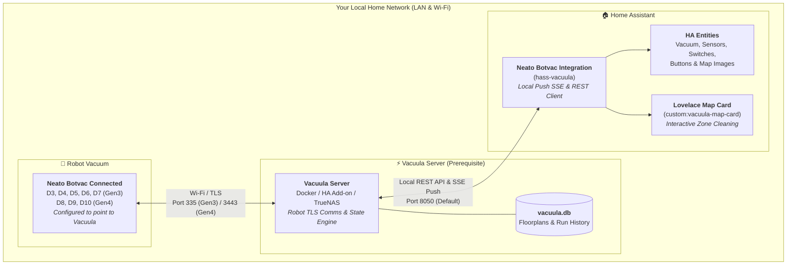

<p align="center">
  
</p>

<h1 align="center">Neato Botvac for Home Assistant</h1>
<p align="center"><em>Unofficial Community Integration for Vacuula Local Cloud</em></p>

<p align="center">
  <a href="https://github.com/Snuggert/hass-vacuula/actions/workflows/validate.yml"></a>
  <a href="https://github.com/hacs/default"></a>
  <a href="https://github.com/Snuggert/hass-vacuula/releases"></a>
  <a href="https://github.com/Snuggert/hass-vacuula/blob/main/COMPATIBILITY.md"></a>
  <a href="https://www.home-assistant.io/blog/2016/02/12/classifying-the-internet-of-things/"></a>
  <a href="#-architecture--design-highlights"></a>
  <a href="https://github.com/Snuggert/hass-vacuula/blob/main/LICENSE"></a>
</p>

> [!IMPORTANT]
> ### ⚠️ Unofficial Community Integration — Not Affiliated with Vacuula
>
> **This integration is an independent, community-developed project by [@Snuggert](https://github.com/Snuggert).**
> **It is NOT an official Vacuula project and is in NO WAY affiliated with, endorsed by, or supported by the authors of the upstream Vacuula server project.**
>
> 🛑 **DO NOT submit support requests, bug reports, or questions to the upstream Vacuula repository** for any issues concerning this Home Assistant integration or its Lovelace map card.
>
> All issues and support requests must be opened exclusively on this repository:
> 👉 [**Snuggert/hass-vacuula Issues**](https://github.com/Snuggert/hass-vacuula/issues)

> [!WARNING]
> ### ⚡ Prerequisite: A Working Vacuula Server Instance is Required
>
> **This integration does NOT communicate directly with your Neato robot vacuum and does NOT replace the Vacuula server software.**
>
> To use this integration, you **must already have a running instance of the [Vacuula Server](https://github.com/vacuula/vacuula)** (deployed via Docker, Home Assistant Add-on, TrueNAS, or bare metal) and your Neato robot must already be linked and communicating with it.
>
> * **The Robot Vacuum** connects over Wi-Fi directly to your **Vacuula server** (handling Neato cloud replacement, robot TLS connections, firmware comms, and raw map data).
> * **The Vacuula Server** stores floorplans, cleaning runs, and coordinates in its local database (`vacuula.db`) and exposes a local REST API & SSE event stream.
> * **This Integration (`hass-vacuula`)** runs inside Home Assistant and connects to your **Vacuula server** over HTTP/SSE, creating vacuum entities, sensors, room zone selection, and the interactive Lovelace map card.
>
> If you have not set up Vacuula yet, please follow the [official Vacuula setup guide](https://github.com/vacuula/vacuula) before installing this integration.
>
> 📖 **Cross-Version Support**: For a complete version-by-version breakdown of Vacuula server releases (v1.0.0, v1.1.0+), Neato robot generations, and firmware installer compatibility, consult our [**Compatibility Guide**](https://github.com/Snuggert/hass-vacuula/blob/main/COMPATIBILITY.md).

An independent, full-featured, **100% local push** [Home Assistant](https://www.home-assistant.io/) custom integration and bundled interactive Lovelace map card for robot vacuums connecting through [**Vacuula**](https://github.com/vacuula/vacuula) — the local cloud replacement server for **Neato Botvac Connected** (Gen3: D3, D4, D5, D6, D7) and **Gen4** (D8, D9, D10) robot vacuums.

---

## 📐 System Architecture

The diagram below illustrates how your robot vacuum, the Vacuula server, and this Home Assistant integration interact across your local network:



---

## ✨ Visual Showcase

### Bundled Interactive Map Card (`custom:vacuula-map-card`)

The integration automatically registers a zero-dependency Web Component (`custom:vacuula-map-card`) into your Home Assistant Lovelace resources — no separate HACS frontend plugin install required.

<p align="center">
  
</p>

### Pure-Python High-DPI Map Rendering (`image` entities)

Vacuula RLE floorplans, colored room zone polygons, No-Go lines, dock markers, and cleaning run coverage paths are rendered directly in Python with zero external image library dependencies (`zlib`/`struct` RGBA encoder with 2× high-DPI upscaling and automatic bounding-box cropping):

| Saved Floorplan & Room Boundaries (`image.<robot>_floor_map`) | Latest Cleaning Run Coverage (`image.<robot>_last_run_map`) |
| :---: | :---: |
|  |  |

---

## 🚀 Key Capabilities

- **Instant Local Push (SSE) + Fallback Polling**: Subscribes to `/api/events` and per-robot `/api/robot/{serial}/connect` Server-Sent Events streams for sub-second status updates, backed by a 30-second health/state poll.
- **Interactive Room Zone Selection**:
  - Click room pins **directly on the floor map** or toggle room chips in `custom:vacuula-map-card` to dispatch single- or multi-room cleaning runs.
  - Exposes a `select.<robot>_cleaning_category` entity (`Map (All Rooms)`, `House (No Map)`, `Spot`, plus every named room zone on the active map) so `vacuum.start` automatically cleans the chosen target.
  - Dynamically creates one-tap `button.<robot>_clean_<room>` entities for every polygon boundary on the robot's active floorplan.
- **Offline History & Map Persistence**: Server-backed entities (`floor_map`, `last_run_map`, `last_clean_area`, `last_clean_duration`, `total_cleans`, `connected`, `refresh_maps`) remain available in Home Assistant even when the robot is powered down or in deep sleep, as long as the Vacuula server is reachable.
- **Per-Robot Command Serialization**: Built-in `asyncio.Lock` per robot serial prevents concurrent WebSocket command collisions on Gen3 Botvac hardware.
- **Config Entry Reconfiguration & Diagnostics**: Update your Vacuula server URL anytime via **Reconfigure** in the Home Assistant UI, and download JSON diagnostics for the server or individual robots. Robot serials, MAC addresses, secrets, and the server URL are redacted, so diagnostics are safe to attach to GitHub issues.
- **Clear Error Reporting**: If a command fails (robot offline, busy, or server unreachable), Home Assistant shows the error as a notification in the UI instead of logging a stack trace.

---

## 📦 Installation

### Option 1: HACS (Recommended)

1. Open **HACS** in Home Assistant → **Integrations**.
2. Search for **Neato Botvac (Vacuula Client - Unofficial)** (or search **Vacuula**).
3. Click **Download** and restart Home Assistant.
4. Go to **Settings → Devices & Services → Add Integration** and search for **Neato Botvac** (or accept the automatic Zeroconf discovery prompt if `_vacuula._tcp.local.` is advertised on your LAN).

<details>
<summary><b>Custom Repository Fallback (HACS)</b></summary>

If the integration does not appear in your HACS search results yet:
1. Open **HACS** → **Integrations** → top-right menu (**⋮**) → **Custom repositories**.
2. Add `https://github.com/Snuggert/hass-vacuula` with category **Integration**.
3. Click **Download** on **Neato Botvac (Vacuula Client - Unofficial)** and restart Home Assistant.
</details>

### Option 2: Manual Installation

1. Copy the `custom_components/vacuula` folder into your Home Assistant `<config>/custom_components/` directory.
2. Restart Home Assistant.
3. Add **Neato Botvac** via **Settings → Devices & Services → Add Integration** and enter your Vacuula server URL (e.g. `http://vacuula.local:8050` or `http://192.168.1.50:8050`).

### Server URL Format

- Only `http://` and `https://` URLs are accepted. If you omit the scheme (e.g. `192.168.1.50:8085`), `http://` is assumed.
- The URL must include a host and may include a port and path prefix (for reverse proxies). Query strings and fragments are rejected.
- Zeroconf discovery supports IPv4 and routable IPv6 addresses. Link-local addresses (`169.254.x.x`, `fe80::/10`) are ignored, because they are not stable across reboots.

---

## 🗺️ Dashboard Card (`custom:vacuula-map-card`)

When the integration loads, it serves `/vacuula_frontend/vacuula-map-card.js` and automatically registers it in your Lovelace resources.

### Adding via the Visual Editor
1. Edit any Dashboard → **Add Card** → choose **Vacuula Map & Room Card**.
2. Pick your `vacuum.<robot>` entity and customize the display toggles.

### YAML Configuration

```yaml
type: custom:vacuula-map-card
entity: vacuum.mappa
title: Mappa
default_view: floor       # 'floor' (Floor Map) or 'run' (Last Run)
show_zone_labels: true    # Show clickable room pins & zone chip bar
show_controls: true       # Show Start / Pause / Dock / Locate + Power & Nav dropdowns
```

---

## 🧩 Provided Entities (Per Robot)

Entities are organized into primary controls, **Configuration**, and **Diagnostic** categories so your device page stays clean:

| Domain | Entity Suffix | Category | Available When Robot Offline? | Description |
| :--- | :--- | :---: | :---: | :--- |
| `vacuum` | `vacuum.<robot>` | Primary | No | Start, pause, stop, return to dock, locate, spot clean, and fan speed (`eco` / `turbo`). Exposes `available_zones`, `zone_boundaries`, and `active_map_name` attributes. |
| `image` | `image.<robot>_floor_map` | Primary | **Yes** | High-DPI cropped PNG of the active floorplan with colored room polygons, No-Go lines, and dock location. |
| `image` | `image.<robot>_last_run_map` | Primary | **Yes** | High-DPI cropped PNG overlaying the latest cleaning coverage and trajectory onto the floorplan. |
| `select` | `select.<robot>_target_zone` | Primary | No | Target zone used when `vacuum.start` is called: `all` (full map) or any discovered room name on the active floorplan. |
| `button` | `button.<robot>_clean_<zone>` | Primary | No | Auto-generated per-room button for every named polygon boundary on the active map (e.g. *Clean Diningroom*, *Clean Office*). |
| `button` | `button.<robot>_dismiss_alert` | Primary | No | Clears the active alert on Gen3 robots. |
| `sensor` | `sensor.<robot>_battery` | Primary | No | Battery percentage (`%`) with dynamic charging icon. |
| `sensor` | `sensor.<robot>_status_detail` | Primary | No | Human-readable robot state (`Docked`, `Cleaning`, `Returning to Dock`, etc.). |
| `sensor` | `sensor.<robot>_last_clean_area` | Primary | **Yes** | Area covered in the most recent cleaning run (`m²`), with map/run metadata attributes. |
| `sensor` | `sensor.<robot>_last_clean_duration` | Primary | **Yes** | Duration of the most recent cleaning run (`min`). |
| `switch` | `switch.<robot>_schedule` | Config | No | Enables or disables the robot's internal cleaning schedule (Gen3). |
| `select` | `select.<robot>_navigation_mode` | Config | No | Selects navigation profile (`normal`, `extra_care`, `deep` on Gen3; `normal`, `gentle`, `deep` on Gen4). |
| `select` | `select.<robot>_cleaning_mode` | Config | No | Selects Gen3 cleaning category: `map` (persistent map with No-Go lines) vs `house` (unmapped clean). |
| `button` | `button.<robot>_refresh_maps` | Config | **Yes** | Reloads floor maps, room boundaries, and run history from the Vacuula server. |
| `button` | `button.<robot>_explore_map` | Config | No | Starts an initial map-exploration run on Gen4 robots. |
| `binary_sensor` | `binary_sensor.<robot>_connected` | Diagnostic | **Yes** | Live WebSocket connectivity between the Vacuula server and the robot (`connectivity`). |
| `binary_sensor` | `binary_sensor.<robot>_docked` | Diagnostic | No | `on` when the robot is resting on its charging base. |
| `binary_sensor` | `binary_sensor.<robot>_charging` | Diagnostic | No | `on` when the battery is actively charging (`battery_charging`). |
| `binary_sensor` | `binary_sensor.<robot>_bin_full` | Diagnostic | No | `on` when the dustbin is full or missing (`problem`). |
| `binary_sensor` | `binary_sensor.<robot>_dock_seen` | Diagnostic | No | `on` when the robot has localized its charging base during a run. |
| `sensor` | `sensor.<robot>_alert` | Diagnostic | No | Active error or alert code (`none`, `dustbin_full`, `brush_stuck`, etc.). |
| `sensor` | `sensor.<robot>_total_cleans` | Diagnostic | **Yes** | Total historical cleaning runs stored on the Vacuula server. |

---

## ⚡ Custom Actions (Services)

All custom actions accept either `entity_id` (via the standard Home Assistant entity picker) or `serial` (optional when only one robot is paired).

### `vacuula.clean_zones`
Clean one or more named rooms (case-insensitive) or boundary UUIDs on the robot's active floorplan:

```yaml
action: vacuula.clean_zones
data:
  entity_id: vacuum.mappa
  zones:
    - Diningroom
    - Office
  fan_speed: turbo
  navigation_mode: normal
```

### `vacuula.clean_spot`
Start a localized spot clean with custom dimensions (`100`–`400` cm):

```yaml
action: vacuula.clean_spot
data:
  entity_id: vacuum.mappa
  width: 200
  height: 200
  fan_speed: turbo
```

### `vacuula.refresh_maps`
Force an immediate reload of floor maps, room boundaries, and historical run maps from the Vacuula server:

```yaml
action: vacuula.refresh_maps
data:
  entity_id: vacuum.mappa
```

---

## 🤖 Automation Examples

### 1. Clean the Dining Room After Dinner When Everyone Leaves the Room
```yaml
alias: "Vacuum: Clean Diningroom After Dinner"
trigger:
  - platform: state
    entity_id: binary_sensor.dining_room_occupancy
    from: "on"
    to: "off"
    for: "00:15:00"
condition:
  - condition: time
    after: "19:00:00"
    before: "21:30:00"
  - condition: state
    entity_id: vacuum.mappa
    state: "docked"
action:
  - action: vacuula.clean_zones
    data:
      entity_id: vacuum.mappa
      zones:
        - Diningroom
      fan_speed: eco
      navigation_mode: extra_care
```

### 2. Send a Mobile Notification With the Coverage Map When Cleaning Finishes
```yaml
alias: "Vacuum: Cleaning Complete Summary with Map"
trigger:
  - platform: state
    entity_id: vacuum.mappa
    from: "returning"
    to: "docked"
action:
  - action: vacuula.refresh_maps
    data:
      entity_id: vacuum.mappa
  - delay: "00:00:05"
  - action: notify.mobile_app_phone
    data:
      title: "🧹 Mappa finished cleaning!"
      message: >-
        Cleaned {{ states('sensor.mappa_last_clean_area') }} m² in
        {{ states('sensor.mappa_last_clean_duration') }} minutes.
      data:
        image: "/api/image_proxy/image.mappa_last_run_map"
```

---

## 🏗️ Architecture & Developer Guide

- **Architecture Deep Dive**: For details on the coordinator data pipeline, SSE event multiplexing, Gen3/Gen4 protocol normalization, pure-Python RLE PNG rendering, and security safeguards, see [**ARCHITECTURE.md**](https://github.com/Snuggert/hass-vacuula/blob/main/ARCHITECTURE.md).
- **Developer Testing Environment**: For setting up a local dev environment, launching the Vacuula dev server with simulated Neato robots, and running live integration tests, see [**DEVELOPMENT.md**](https://github.com/Snuggert/hass-vacuula/blob/main/DEVELOPMENT.md).
- **Cross-Version Compatibility Matrix**: For compatibility across Vacuula server releases (v1.0.0, v1.0.1, v1.1.0+), see [**COMPATIBILITY.md**](https://github.com/Snuggert/hass-vacuula/blob/main/COMPATIBILITY.md).
- **Release History**: Release notes for each version are in [**CHANGELOG.md**](https://github.com/Snuggert/hass-vacuula/blob/main/CHANGELOG.md).

---

## 📄 License & Disclaimers

- **Integration & Lovelace Card Code**: Licensed under the [**MIT License**](https://github.com/Snuggert/hass-vacuula/blob/main/LICENSE).
- **Brand Assets**: The integration icons and logos are original artwork designed in the Home Assistant Material Design style specifically for this integration. They do not use any artwork, trademarks, or assets from the Vacuula project. See [**docs/brands.md**](https://github.com/Snuggert/hass-vacuula/blob/main/docs/brands.md) for brand asset specifications and dark theme guidelines.
- **Independence & Disclaimer**: This project is an independent community client integration developed by [@Snuggert](https://github.com/Snuggert). It is **not** affiliated with, maintained by, or endorsed by Neato Robotics or the upstream [Vacuula](https://github.com/vacuula/vacuula) server project. All support inquiries and bug reports must be directed exclusively to [**Snuggert/hass-vacuula Issues**](https://github.com/Snuggert/hass-vacuula/issues).
